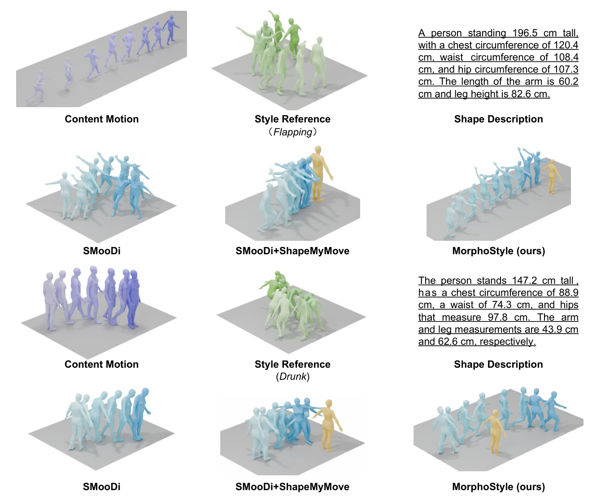
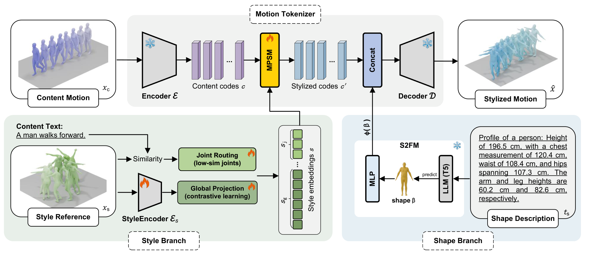

<p align="center">
  <h1 align="center">MorphoStyle: Motion Style Transfer with Morphology Control</h1>

  <div align="center">

Accepted at [BMVC 2026](https://bmvc2026.bmva.org/programme/accepted_papers/)

[Xin Feng](https://scholar.google.com/citations?user=dkfbz90AAAAJ&hl=en),
[Eleonora D'Arnese](https://scholar.google.com/citations?user=cUYzSgYAAAAJ&hl=it),
[Mohan Sridharan](https://scholar.google.com/citations?user=pKV2QvsAAAAJ&hl=en)

Institute of Perception, Action and Behaviour, School of Informatics, University of Edinburgh

  </div>

  <div align="center">
    
  </div>
</p>

Two content motions, two style references and two target shapes. The yellow body is the target shape given to the
model, shown for reference; SMooDi has no shape input, so the yellow body appears only in the two shape-aware columns.

## Release plan

- [x] Data preparation
- [x] Training code
- [ ] Inference code and evaluation
- [ ] Pretrained weights
- [ ] Demo and visualisation

## Overview

MorphoStyle transfers the style of a reference motion onto a content motion while respecting a target body shape. A frozen
shape-conditioned FSQ-VAE from [ShapeMyMove](https://github.com/shape-move/shape-move-public) tokenises the content motion; on
top of it we train a contrastive style encoder, a text-guided routing module that finds the style-relevant joints, and a
manifold-preserving modulator that adds the style as a temporally gated low-rank offset on the content codes. Motions are
263-d HumanML3D features at 20 fps and the body shape is a 10-d SMPL beta.



```
train/train_ext_jtc_distill.py   trainer
train/model/                     style branch, losses, frozen backbone code
train/dataset/                   100STYLE and HumanML3D loaders
train/data_prep/                 builds data/ and the train / val splits
train/configs/                   base.yaml, finetune.yaml
```

## Setup

```bash
conda create -n morphostyle python=3.10 -y && conda activate morphostyle
pip install torch==2.4.1 --index-url https://download.pytorch.org/whl/cu118
pip install -r requirements.txt
```

Training also needs these third-party files, which are not redistributed here:

- [ShapeMyMove](https://github.com/shape-move/shape-move-public): its data processing for the shape-aware HumanML3D
  variants, and its SA-VAE checkpoint, saved as `checkpoints/shapemymove_savae.pt`;
- [SMooDi](https://github.com/neu-vi/SMooDi): a code checkout with `PRETRAINED_WEIGHTS/style_classifier.pt` and its
  `datasets/` folder, plus its SMPL-retargeted 100STYLE motions; the configs look for it at `../SMooDi`;
- the text-motion evaluator of [Guo et al.](https://github.com/EricGuo5513/text-to-motion)
  (`t2m/text_mot_match/model/finest.tar`), saved as `assets/t2m/finest.tar`.

The GloVe vectors, the HumanML3D feature statistics and the classifier used by the style and content losses are in `assets/`.

## Data preparation

1. Get [HumanML3D](https://github.com/EricGuo5513/HumanML3D) with its `texts/`, `new_joints/` and the official `train.txt`,
   `val.txt` and `test.txt`.
2. Run ShapeMyMove's data processing on it. It writes `Xn/new_joint_vecs` (each motion on the neutral body),
   `Xr/new_joint_vecs` (the motion retargeted to a sampled SMPL body) and `betas/<id>_shape.npy` (that body's beta).
3. Download SMooDi's retargeted 100STYLE (`new_joint_vecs/`).
4. Build `data/`:

```bash
python train/data_prep/prepare_data.py --humanml3d /path/to/HumanML3D --shapemymove /path/to/shapemymove_data \
    --style100 /path/to/100STYLE_retargeted --smoodi /path/to/SMooDi
```

The script links the motion folders into `data/` and writes the official HumanML3D train and val lists and the 100STYLE
training clips (the 47-style split; `--style_split Full` takes all 100 styles). It stops if a test clip is in a training
list and leaves out the mirrored copies of test clips, which the official 100STYLE split places in train. `data/SPLITS.json`
records the counts and checksums.

## Training

```bash
export PYTHONPATH=$PWD/train:$PYTHONPATH
# base configuration: the style branch on the frozen backbone
python train/train_ext_jtc_distill.py --config train/configs/base.yaml --gpu 0
# fine-tuning configuration: continues from the base run with the foot-contact and trajectory losses
python train/train_ext_jtc_distill.py --config train/configs/finetune.yaml --gpu 0 \
    --resume outputs/train/morphostyle_base/latest.pt
```

Checkpoints go to `outputs/train/<name>/`. `--max_steps 200` stops after 200 training steps and saves a checkpoint, a quick check of the setup.
`train/README.md` describes the code and the two configurations.

## Citation

```bibtex
@inproceedings{morphostyle2026,
  title     = {MorphoStyle: Motion Style Transfer with Morphology Control},
  author    = {Feng, Xin and D'Arnese, Eleonora and Sridharan, Mohan},
  booktitle = {British Machine Vision Conference (BMVC)},
  year      = {2026}
}
```

## Acknowledgements

MorphoStyle builds on [ShapeMyMove](https://github.com/shape-move/shape-move-public) for the shape-conditioned FSQ-VAE backbone and
the data pipeline, on [SMooDi](https://github.com/neu-vi/SMooDi) for the retargeted 100STYLE data and its style classifier, and on
the text-motion evaluator of [Guo et al.](https://github.com/EricGuo5513/text-to-motion). Thanks to all of them for releasing their
code.

## License

The code is MIT licensed (see `LICENSE`). The SMPL body model, the HumanML3D and 100STYLE data and the third-party
checkpoints keep their own licences.
